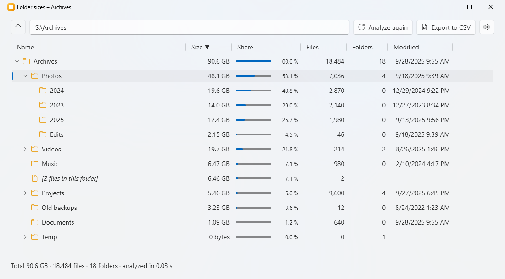

<p align="center">
  
</p>

<h1 align="center">FolderTools</h1>

<p align="center">
  Voir ce qui prend de la place dans un dossier, et nettoyer ses dossiers vides, directement depuis le menu clic droit de Windows 11.
</p>

<p align="center">
  <a href="README.md">English</a> · <b>Français</b>
</p>

<p align="center">
  
</p>

---

## Fonctionnalités

- **Clic droit sur un dossier, un lecteur ou le fond d'un dossier ouvert → « FolderTools › »**, dans le nouveau menu
  de Windows 11 (et dans « Afficher plus d'options » / sous Windows 10), avec deux outils :

### Taille des dossiers

- Le dossier en **arborescence** : chaque sous-dossier avec sa **taille**, son **nombre de fichiers** et de
  **sous-dossiers** (à tous les niveaux), sa **part du dossier parent** (avec une barre) et la date de son **fichier
  le plus récent**.
- Du plus gros au plus petit ; un clic sur un en-tête de colonne trie par nom, fichiers, dossiers ou date.
- Les fichiers posés directement dans un dossier ont leur propre ligne (`[12 fichiers dans ce dossier]`), pour que
  les lignes s'additionnent.
- Rapide : les premiers niveaux sont lus en parallèle (un disque système entier de 400 Go, 1,3 million de fichiers,
  en moins d'une minute sur un SSD). Les dossiers apparaissent dès qu'ils sont mesurés ; **Annuler** arrête l'analyse.
- Les fichiers cachés et système sont comptés. Les jonctions et liens symboliques sont affichés mais pas suivis
  (leur cible est comptée là où elle se trouve) ; les dossiers OneDrive sont lus normalement.
- Clic droit sur une ligne : **ouvrir dans l'Explorateur**, **copier le chemin**, **afficher seulement ce dossier**,
  **supprimer** (vers la corbeille, après confirmation).
- **Export CSV** (pour Excel) : une ligne par dossier, avec le séparateur et la virgule décimale de vos paramètres régionaux.
- Les dossiers illisibles (accès refusé) sont comptés et signalés, avec un bouton **Relancer en administrateur**.

### Supprimer les dossiers vides

- Trouve les dossiers vides, **les affiche d'abord** (tous cochés), et ne supprime que ceux qui restent cochés.
- Un dossier qui ne contient que des dossiers vides compte comme vide : il est listé une fois (« + 3 sous-dossiers
  vides ») et part avec eux.
- **Fichiers ignorés** : un dossier qui ne contient que `Thumbs.db`, `desktop.ini` ou `.DS_Store` compte comme vide
  (liste modifiable dans les paramètres, `*` et `?` acceptés).
- **Dossiers ignorés** : `.git`, `.svn` et `.hg` ne sont jamais explorés ni supprimés, et un dossier qui en contient un
  n'est pas vide : les dépôts de gestion de versions ont besoin de leurs dossiers vides (liste modifiable dans les paramètres).
- Le dossier de départ n'est jamais supprimé, pas plus que les jonctions et liens symboliques.
- Chaque dossier est revérifié juste avant d'être supprimé : un fichier créé entre-temps le conserve.
- **Corbeille** (par défaut) ou **suppression définitive** (avec une confirmation de plus), au choix dans les paramètres.
- Un avertissement s'affiche pour les dossiers système et de profil (Windows, Program Files, ProgramData, un lecteur
  entier…), où certains programmes ont besoin de leurs dossiers vides.
- Pratique pour le **dossier temporaire** de Windows : la fenêtre d'accueil a un lien *Dossier temporaire*.

### Et aussi

- Apparence Windows 11 (Fluent, Mica) qui **suit le thème clair/sombre** de Windows ; le thème peut aussi être forcé
  en clair ou en sombre dans les **Paramètres**.
- **Français et anglais** : l'application, le menu clic droit et l'installeur suivent la langue d'affichage de
  Windows ; la langue de l'application peut aussi être choisie dans les **Paramètres**.
- L'entrée du nouveau menu de Windows 11 peut être **désactivée** dans les paramètres ; elle reste alors dans
  « Afficher plus d'options ».
- **Mises à jour en un clic** : au démarrage, l'application consulte les Releases GitHub ; un bandeau en haut de chaque
  fenêtre propose la nouvelle version (**Nouveautés** / **Mettre à jour**), qui s'installe et redémarre l'application. Dans les **Paramètres** : vérifier maintenant,
  désactiver la vérification au démarrage, ou choisir le canal **Bêta** pour recevoir les nouveautés en avance.

## Installation

1. Téléchargez `FolderTools-Setup-x.y.z.exe` depuis la page [Releases](../../releases).
2. Lancez-le. L'installeur n'étant pas signé, Windows SmartScreen peut afficher « Windows a protégé votre ordinateur » :
   cliquez sur **Informations complémentaires → Exécuter quand même**.
3. Acceptez la demande d'administrateur (UAC).

L'installeur :

- copie l'application dans `C:\Program Files\FolderTools` et l'ajoute au menu Démarrer ;
- ajoute l'entrée « FolderTools › » au menu clic droit des dossiers, des lecteurs et du fond des dossiers ;
- propose d'installer le **.NET 10 Desktop Runtime** de Microsoft s'il est absent.

Mettre à jour : l'application propose elle-même les nouvelles versions (bandeau en haut de ses fenêtres, ou
**Paramètres → Mises à jour**) ; l'installation redemande l'accord administrateur.

Désinstaller : **Paramètres → Applications → Applications installées → FolderTools**. La désinstallation retire :

- l'application (`C:\Program Files\FolderTools`), son raccourci du menu Démarrer et son entrée de désinstallation ;
- le menu clic droit : les entrées classiques (dossiers, fond des dossiers, lecteurs) et le package du menu de
  Windows 11, pour tous les comptes Windows ;
- pour le compte qui accepte la demande d'administrateur : les paramètres (`%LOCALAPPDATA%\FolderTools`), le réglage
  du menu (`HKCU\Software\FolderTools`), un installeur de mise à jour téléchargé (`%TEMP%\FolderTools-Update`) et les
  noms que Windows a mis en cache pour l'application (`MuiCache`).

Elle garde :

- les paramètres des **autres** comptes Windows (un désinstalleur ne peut pas les atteindre ; ce n'est qu'un petit
  `settings.json` par compte) ;
- le .NET Desktop Runtime (d'autres applications peuvent s'en servir) ;
- ce que vous avez produit avec l'application : exports CSV, dossiers envoyés à la corbeille.

Une mise à jour installée par-dessus ne désinstalle pas l'application : les paramètres restent. Si l'Explorateur
avait encore le menu chargé, Windows termine la suppression du dossier d'installation au prochain redémarrage.

**Configuration requise :** Windows 11 x64 pour le nouveau menu clic droit (Windows 10 2004+ fonctionne, avec
l'entrée dans le menu classique). Dans le nouveau menu de Windows 11, l'entrée apparaît sur les dossiers et le fond des
dossiers ; sur un **lecteur**, elle est dans « Afficher plus d'options » (Windows ne permet pas aux entrées de menu
empaquetées de viser les lecteurs).

## Développement

### Prérequis

Tout s'installe avec `winget` (intégré à Windows 11), depuis un terminal :

| Outil | Rôle | Installation |
|-------|------|--------------|
| **Git** | Récupérer le code | `winget install Git.Git` |
| **SDK .NET 10** | Compiler l'application (C# / WPF) et lancer les tests | `winget install Microsoft.DotNet.SDK.10` |
| **Visual Studio Build Tools 2026**, charge de travail « Développement Desktop en C++ » | Compiler la DLL du menu (MSVC, CMake, Ninja) et le package MSIX (`makeappx`, SDK Windows 10.0.26100) | voir ci-dessous |
| **Inno Setup 6** | Construire l'installeur | `winget install JRSoftware.InnoSetup` |

```powershell
winget install Microsoft.VisualStudio.BuildTools --override "--quiet --wait --norestart --add Microsoft.VisualStudio.Workload.VCTools --includeRecommended"
```

### Compiler

```powershell
.\scripts\build.ps1
```

Le script lance les tests, puis produit dans `dist\` :

| Fichier | Contenu |
|---------|---------|
| `app\` | l'application (`FolderTools.exe`…) et la DLL du menu (`FolderToolsMenu.dll`) |
| `FolderTools.Menu.msix` | le package « sparse » qui déclare l'entrée du menu de Windows 11 |
| `FolderTools-Setup-<version>.exe` | l'installeur |

Options : `-SkipTests`, `-NoInstaller`.

### Pendant le développement

```powershell
dotnet test tests\FolderTools.Tests                              # tests unitaires
dotnet run --project src\FolderTools                             # fenêtre d'accueil
dotnet run --project src\FolderTools -- size "D:\Photos"         # taille des dossiers
dotnet run --project src\FolderTools -- clean "%TEMP%"           # dossiers vides
```

Définissez la variable d'environnement `FOLDERTOOLS_THEME` à `Light` ou `Dark`, ou `FOLDERTOOLS_LANG` à `en` ou `fr`,
avant de lancer l'application pour vérifier l'autre thème ou l'autre langue sans toucher aux paramètres.

Le menu clic droit ne se teste qu'**installé** : lancez `dist\FolderTools-Setup-<version>.exe` (une nouvelle
installation remplace la précédente).

### Organisation du code

```
src/
  FolderTools.Core/     Logique sans interface : analyse des dossiers, recherche et suppression des dossiers vides, export CSV, tailles, ligne de commande, mises à jour
  FolderTools/          Application WPF : accueil, arborescence des tailles, fenêtre de nettoyage, paramètres, mises à jour, textes
  FolderTools.Shell/    DLL C++ du menu clic droit de Windows 11 (IExplorerCommand), avec ses libellés traduits et ses icônes
package/                Manifeste et logos du package « sparse » (l'identité de l'application pour le menu de Windows 11)
installer/              Script Inno Setup de l'installeur
scripts/                build.ps1 (compilation complète), make-icons.ps1 (régénère les icônes)
tests/                  Tests unitaires (xUnit)
docs/                   Icône du README
.github/workflows/      Compilation automatique sur GitHub (et publication des versions)
tools/                  Outil de dev : InvokeMenu (lance les commandes du menu installé comme l'Explorateur)
```

### Traductions

| Quoi | Où |
|------|-----|
| Textes de l'application | `src/FolderTools/Properties/Strings.resx` (anglais, par défaut) et `Strings.fr.resx` (français). Les tests vérifient que les deux ont les mêmes clés et les mêmes paramètres. |
| Libellés du menu clic droit | Tables de chaînes dans `src/FolderTools.Shell/FolderToolsMenu.rc` |
| Messages de l'installeur | `[Languages]` et `[CustomMessages]` dans `installer/FolderTools.iss` |
| Langues proposées dans les paramètres | `AppSettings.SupportedLanguages` dans `src/FolderTools/AppSettings.cs` |

### Comment fonctionne le menu de Windows 11

Le nouveau menu clic droit n'accepte que les applications qui ont une **identité de package**. L'application reste une
application de bureau classique, mais l'installeur enregistre un petit package « sparse » (`package/AppxManifest.xml`)
qui pointe vers le dossier d'installation et déclare `FolderToolsMenu.dll`. Cette DLL affiche « FolderTools › » et ses
deux entrées, puis demande à l'Explorateur de lancer `FolderTools.exe size|clean "<dossier>"`. Ce package **n'est pas
signé** : Windows 11 l'accepte avec `Add-AppxPackage -AllowUnsigned` depuis une session administrateur, d'où la
demande UAC pendant l'installation.

### Publier une version

1. Mettre à jour `<Version>` dans `Directory.Build.props`.
2. Commiter, puis créer et pousser un tag : `git tag v1.1.0`, puis `git push origin v1.1.0`.
3. Le workflow GitHub Actions compile, teste et publie l'installeur dans une Release.

**Version bêta :** mêmes étapes avec un numéro de préversion, par exemple `<Version>1.1.0-beta.1</Version>` et le tag
`v1.1.0-beta.1`. Le workflow la publie comme *pre-release* : seuls les utilisateurs du canal **Bêta** se la voient proposer.

## Feuille de route

- [ ] **Couleurs de dossiers**, comme les étiquettes de macOS : « FolderTools › Couleur › » pose une icône de dossier colorée.
- [ ] **Signature gratuite** de l'installeur et du package via [SignPath Foundation](https://signpath.org) : plus
      d'avertissement SmartScreen, et plus besoin de droits administrateur pour le menu.
- [ ] Version ARM64.
- [ ] D'autres langues.

## Politique de confidentialité

Ce programme ne transfère aucune information vers d'autres systèmes en réseau, sauf à la demande expresse de
l'utilisateur, avec une exception : la **vérification des mises à jour**. Les noms, tailles et contenus de vos
dossiers ne quittent jamais votre ordinateur.

- **Vérification des mises à jour :** au lancement de l'application (depuis le menu Démarrer ou le menu clic droit), et
  quand vous cliquez sur *Rechercher des mises à jour*, l'application envoie une requête HTTPS à l'API de GitHub (`api.github.com`) pour lire la liste des
  versions de ce dépôt. La requête ne contient aucune donnée personnelle ni rien sur vos dossiers ; comme toute
  requête web, elle permet à GitHub de voir votre adresse IP et la version de l'application (User-Agent). La
  [déclaration de confidentialité](https://docs.github.com/site-policy/privacy-policies/github-general-privacy-statement)
  de GitHub s'applique. La vérification au démarrage se désactive dans **Paramètres → Mises à jour → Rechercher les
  mises à jour au démarrage**.
- **Téléchargement d'une mise à jour :** un nouvel installeur n'est téléchargé depuis GitHub que lorsque vous cliquez
  sur **Mettre à jour**.
- **Liens** (*Nouveautés*, *Code source sur GitHub*…) : ils ne s'ouvrent dans votre navigateur que lorsque vous cliquez dessus.

## Licence

[MIT](LICENSE.md).

## Crédits

Développé par [QuentinPerou](https://github.com/quentinperou), avec [Claude Code](https://claude.com/claude-code) (Anthropic).
