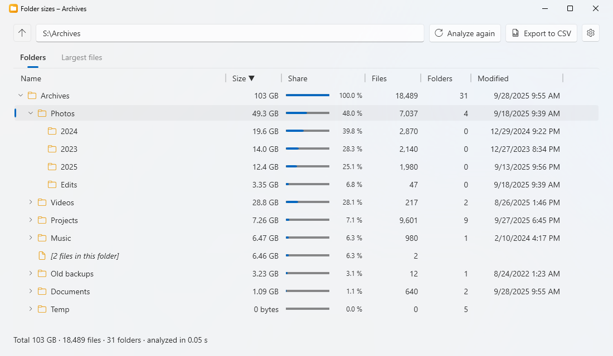
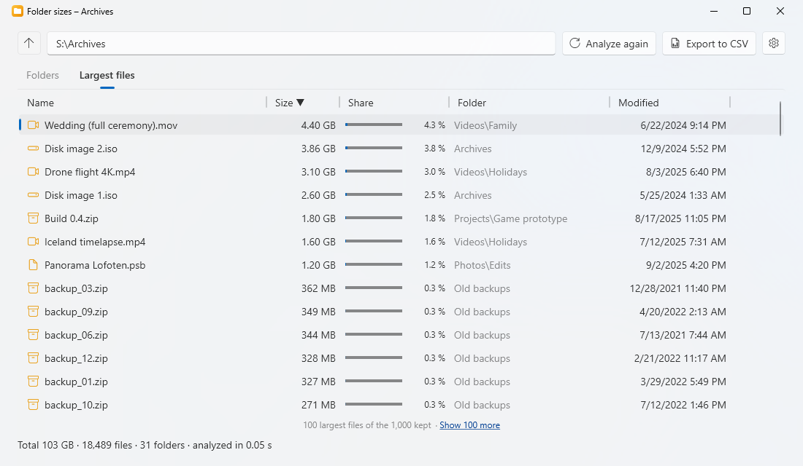
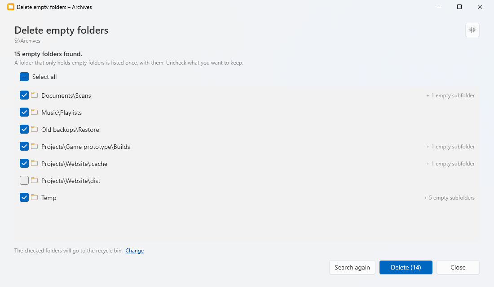
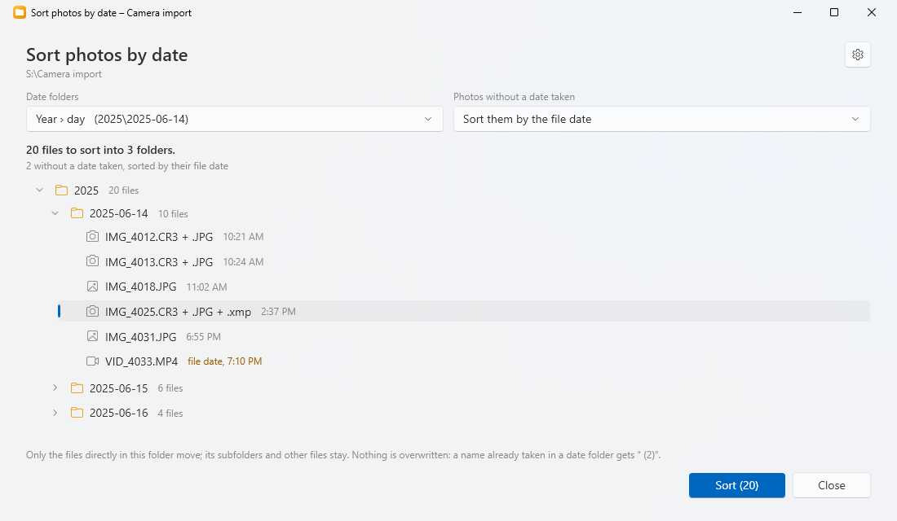
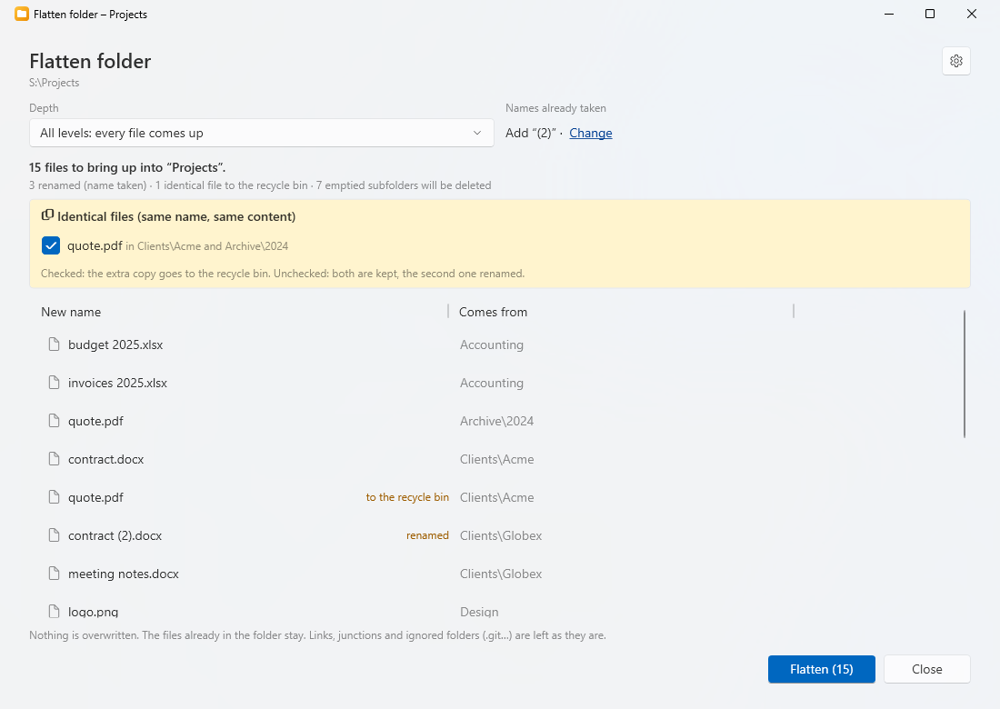
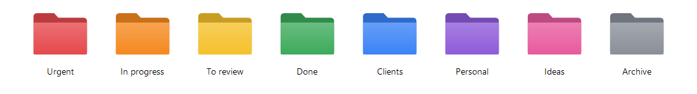

<p align="center">
  
</p>

<h1 align="center">FolderTools</h1>

<p align="center">
  See what takes room in a folder, and clean up its empty folders, straight from the Windows 11 right-click menu.
</p>

<p align="center">
  <b>English</b> · <a href="README.fr.md">Français</a>
</p>

<p align="center">
  
</p>

---

## Features

- **Right-click a folder, a drive or the background of an open folder → “FolderTools ›”**, in the new Windows 11
  context menu (and under “Show more options” / on Windows 10), with four tools and, on folders, the folder colors:

### Folder sizes

- The folder as a **tree**: every subfolder with its **size**, its **number of files** and **subfolders** (at every
  level), its **share of the folder above** (with a bar) and the date of its **newest file**.
- Biggest first; click a column header to sort by name, files, folders or date.
- The files sitting directly in a folder get their own line (`[12 files in this folder]`), so that the lines add up.
- Fast: the first levels are read in parallel (a whole 400 GB system drive, 1.3 million files, in under a minute on
  an SSD). The folders appear as soon as they are measured; **Cancel** stops the analysis.
- Hidden and system files are counted. Junctions and symbolic links are shown but not followed (their target is
  counted where it lives); OneDrive folders are read normally.
- Right-click a line: **open in File Explorer**, **copy the path**, **show only this folder**, **delete** (to the
  recycle bin, after confirmation).
- **Largest files** tab: the largest files of the folder (the analysis keeps the 1,000 largest), with their size,
  share, folder and date, 100 at a time. Double-click shows the file in File Explorer; right-click: open, show in
  File Explorer, copy the path, delete (to the recycle bin, the folder totals follow).
- **Export to CSV** (for Excel), the tab shown: one line per folder or per file, with the separator and decimal mark
  of your regional settings.
- Folders that cannot be read (access denied) are counted and reported, with a **Run as administrator** button.

<p align="center">
  
</p>

### Delete empty folders

- Finds the empty folders, **shows them first** (all checked), and deletes only the ones left checked.
- A folder that only holds empty folders counts as empty: it is listed once (“+ 3 empty subfolders”) and goes with them.
- **Ignored files**: a folder that only holds `Thumbs.db`, `desktop.ini` or `.DS_Store` counts as empty (the list can
  be changed in Settings, `*` and `?` allowed).
- **Ignored folders**: `.git`, `.svn` and `.hg` are never looked into nor deleted, and a folder holding one is not
  empty: version control repositories need their empty folders (the list can be changed in Settings).
- The folder you started from is never deleted, nor are junctions and symbolic links.
- Each folder is checked again just before being deleted: a file created in the meantime keeps it.
- **Recycle bin** (default) or **deleted for good** (with one more confirmation), chosen in Settings.
- A warning shows for system and profile folders (Windows, Program Files, ProgramData, a whole drive…), where
  some programs need their empty folders.
- Handy for the **temporary folder** of Windows: the home window has a *Temporary folder* link.

<p align="center">
  
</p>

### Sort photos by date

- Moves the **photos, RAW files and videos** sitting directly in the folder into **date folders** inside it, from
  their **date taken** (EXIF for photos and RAW files, creation date for videos).
- Date folders to choose from (in Settings, or right in the window): **Year › day** (`2025\2025-06-14`, default),
  Year › month › day (`2025\06\14`), Year › month (`2025\06`) or Day (`2025-06-14`).
- Photos **without a date taken** (screenshots, downloaded pictures…): sorted by their **file date**, put in a
  **No date** folder, or **left where they are**, as you choose.
- A RAW file and the JPEG of the same name stay together, with their sidecar files (`.xmp`, `.aae`…).
- **Preview first**: the date folders and what goes in each, then **Sort**. Nothing is overwritten (a name already
  taken in a date folder gets “ (2)”); subfolders and other files never move.
- **Undo the sort**: puts every file back and removes the date folders it created, when they are empty again.

<p align="center">
  
</p>

### Flatten folder

- Brings the files of the **subfolders** up into the folder itself, then deletes the subfolders left empty.
- **Depth**, chosen in the window: **all levels** (every file comes up, however deep), or **one level** (the files
  of the direct subfolders come up, and their own subfolders come up one level, whole).
- **Names already taken**: nothing is overwritten. The file that comes up gets “ (2)”, or the names of the folders it
  came from (`Holidays - IMG_001.jpg`), as set in Settings; the other files keep their name.
- **Identical files** (same name, same content) are listed first: checked, the extra copy goes to the recycle bin;
  unchecked, both are kept.
- **Preview first**: every file with its new name and where it comes from, then **Flatten**.
- Ignored folders (`.git`…), links and junctions are left as they are; ignored files (`Thumbs.db`…) go with their
  folder.
- **Undo**: puts every file back and creates the deleted subfolders again (while the window is open).

<p align="center">
  
</p>

### Folder color

- **Right-click a folder → FolderTools ›**, below the tools: red, orange, yellow, green, blue, purple, pink or gray,
  like the tags of macOS; **Default color** gives the folder its own icon back. Works on several selected folders at
  once; the current color is checked.
- The folder gets a colored folder icon in the style of Windows 11, through the same `desktop.ini` setting as
  Properties → Customize → Change Icon. A folder that already had its own icon (Downloads, Documents…) gets it back
  with *Default color*; its other settings (such as its translated name) are never touched.
- Good to know: the color is the folder's icon, nothing more. It cannot be searched like a macOS tag, and a colored
  folder no longer shows a preview of its content in large icons. The icons live in the FolderTools folder: on a PC
  without FolderTools (or after uninstalling it), colored folders look like ordinary ones. Drives cannot be colored.
- On Windows 10 it works the same (classic menu), with Windows 11 style icons among Windows 10 style folders.

<p align="center">
  
</p>

### And also

- Windows 11 look (Fluent, Mica) that **follows the light/dark theme** of Windows; the theme can also be set to
  light or dark in **Settings**.
- **English and French**: the app, the context menu and the installer follow the Windows display language; the
  app language can also be chosen in **Settings**.
- The context menu entries can be **turned off** in Settings, all together or one by one (Folder sizes, Delete empty
  folders, Sort photos by date, Flatten folder, Folder color).
- **Updates in one click**: at startup the app checks the GitHub Releases; a bar at the top of every window offers
  the new version (**What's new** / **Update**), which installs itself and restarts the app. In **Settings**: check now, turn off the check at startup, or
  choose the **Beta** channel to get new versions earlier.

## Installation

1. Download `FolderTools-Setup-x.y.z.exe` from the [Releases](../../releases) page.
2. Run it. As the installer is not signed, Windows SmartScreen may show “Windows protected your PC”:
   click **More info → Run anyway**.
3. Accept the administrator prompt (UAC).

The installer:

- copies the app to `C:\Program Files\FolderTools` and adds it to the Start menu;
- adds the “FolderTools ›” entry to the right-click menu of folders, drives and folder backgrounds;
- offers to install the Microsoft **.NET 10 Desktop Runtime** if it is missing.

To update: the app offers new versions itself (a bar at the top of its windows, or **Settings → Updates**); installing
one asks for the administrator prompt again.

To uninstall: **Settings → Apps → Installed apps → FolderTools**. It removes:

- the app (`C:\Program Files\FolderTools`), its Start menu shortcut and its uninstall entry;
- the context menu: the classic entries (folders, folder backgrounds, drives) and the Windows 11 menu package, for
  every Windows account;
- for the account that accepts the administrator prompt: the settings (`%LOCALAPPDATA%\FolderTools`), the menu
  setting (`HKCU\Software\FolderTools`), a downloaded update installer (`%TEMP%\FolderTools-Update`), and the names
  Windows cached for the app (`MuiCache`).

It keeps:

- the color of colored folders, in their `desktop.ini`: without the FolderTools icons they look like ordinary folders,
  and installing FolderTools again brings their colors back;
- the settings of the **other** Windows accounts (an uninstaller cannot reach them; each is a small `settings.json`);
- the .NET Desktop Runtime (other apps may use it);
- what you made with the app: CSV exports, folders sent to the recycle bin.

An update installed over the app does not uninstall it: the settings stay. If File Explorer still had the menu
loaded, Windows finishes deleting the install folder at the next restart.

**Requirements:** Windows 11 x64 for the new context menu (Windows 10 2004+ works, with the entry in the classic
menu). On Windows 11, the entries show on folders and folder backgrounds, in the new menu and under “Show more
options”; on a **drive**, FolderTools is only under “Show more options” (Windows does not let packaged menu entries
target drives).

## Development

### Prerequisites

Everything installs with `winget` (built into Windows 11), from a terminal:

| Tool | Purpose | Install |
|------|---------|---------|
| **Git** | Get the code | `winget install Git.Git` |
| **.NET 10 SDK** | Build the app (C# / WPF) and run the tests | `winget install Microsoft.DotNet.SDK.10` |
| **Visual Studio Build Tools 2026**, “Desktop development with C++” workload | Build the context menu DLL (MSVC, CMake, Ninja) and the MSIX package (`makeappx`, Windows SDK 10.0.26100) | see below |
| **Inno Setup 6** | Build the installer | `winget install JRSoftware.InnoSetup` |

```powershell
winget install Microsoft.VisualStudio.BuildTools --override "--quiet --wait --norestart --add Microsoft.VisualStudio.Workload.VCTools --includeRecommended"
```

### Build

```powershell
.\scripts\build.ps1
```

The script runs the tests, then produces in `dist\`:

| File | Content |
|------|---------|
| `app\` | the app (`FolderTools.exe`…) and the menu DLL (`FolderToolsMenu.dll`) |
| `FolderTools.Menu.msix` | the “sparse” package that declares the Windows 11 menu entry |
| `FolderTools-Setup-<version>.exe` | the installer |

Options: `-SkipTests`, `-NoInstaller`.

### While developing

```powershell
dotnet test tests\FolderTools.Tests                              # unit tests
dotnet run --project src\FolderTools                             # home window
dotnet run --project src\FolderTools -- size "D:\Photos"         # folder sizes
dotnet run --project src\FolderTools -- clean "%TEMP%"           # empty folders
dotnet run --project src\FolderTools -- photos "D:\Import"       # sort photos by date
dotnet run --project src\FolderTools -- flatten "D:\Projects"    # flatten folder
```

Set the `FOLDERTOOLS_THEME` environment variable to `Light` or `Dark`, or `FOLDERTOOLS_LANG` to `en` or `fr`,
before starting the app to check the other theme or language without changing any setting.

The context menu can only be tested **installed**: run `dist\FolderTools-Setup-<version>.exe` (installing again
replaces the previous install).

### Code layout

```
src/
  FolderTools.Core/     Logic without UI: folder scan, empty folder search and deletion, photo sort, flatten, CSV export, sizes, command line, update feed
  FolderTools/          WPF app: home, size tree, cleaning window, photo sort and flatten windows, settings, updates, UI strings
  FolderTools.Shell/    C++ DLL for the Windows 11 context menu (IExplorerCommand), with its localized labels and icons
package/                Manifest and logos of the “sparse” package (the app identity for the Windows 11 menu)
installer/              Inno Setup script of the installer
scripts/                build.ps1 (full build), make-icons.ps1 (regenerates the icons)
tests/                  Unit tests (xUnit)
docs/                   README icon
.github/workflows/      Automated build on GitHub (and release publishing)
tools/                  Dev tool: InvokeMenu (runs the installed menu commands like File Explorer)
```

### Translations

| What | Where |
|------|-------|
| App texts | `src/FolderTools/Properties/Strings.resx` (English, the default) and `Strings.fr.resx` (French). The tests check that both have the same keys and placeholders. |
| Context menu labels (entries and colors) | String tables in `src/FolderTools.Shell/FolderToolsMenu.rc` |
| Installer messages | `[Languages]` and `[CustomMessages]` in `installer/FolderTools.iss` |
| Languages offered in Settings | `AppSettings.SupportedLanguages` in `src/FolderTools/AppSettings.cs` |

### How the Windows 11 menu works

The new context menu only accepts apps that have a **package identity**. The app remains a classic desktop app,
but the installer registers a small “sparse” package (`package/AppxManifest.xml`) that points at the install folder
and declares `FolderToolsMenu.dll`, which shows “FolderTools ›” and its entries and asks File Explorer to start
`FolderTools.exe size|clean|photos|flatten "<folder>"`. This package is **not signed**: Windows 11 accepts it with
`Add-AppxPackage -AllowUnsigned` from an administrator session, hence the UAC prompt during installation.

### Releasing a version

1. Update `<Version>` in `Directory.Build.props`.
2. Commit, then create and push a tag: `git tag v1.1.0`, then `git push origin v1.1.0`.
3. The GitHub Actions workflow builds, tests and publishes the installer in a Release.

**Beta version:** same steps with a pre-release number, e.g. `<Version>1.1.0-beta.1</Version>` and the tag
`v1.1.0-beta.1`. The workflow publishes it as a *pre-release*: only users on the **Beta** channel are offered it.

## Roadmap

- [ ] **Duplicates**: find identical files (compared by hash), with a preview before deleting.
- [ ] Colored folder icons in the style of Windows 10, picked automatically on Windows 10.
- [ ] **Free signing** of the installer and package through [SignPath Foundation](https://signpath.org): no more
      SmartScreen warning, and no administrator rights needed for the menu.
- [ ] ARM64 build.
- [ ] More languages.

## Privacy policy

This program will not transfer any information to other networked systems unless specifically requested by the
user, with one exception: the **update check**. The names, sizes and contents of your folders never leave your computer.

- **Update check:** when the app starts (from the Start menu or the right-click menu), and when you click
  *Check for updates*, the app sends one HTTPS
  request to the GitHub API (`api.github.com`) to read the list of releases of this repository. The request
  contains no personal data and nothing about your folders; like any web request, it lets GitHub see your IP
  address and the app version (User-Agent). GitHub's [privacy statement](https://docs.github.com/site-policy/privacy-policies/github-general-privacy-statement)
  applies. The check at startup can be turned off in **Settings → Updates → Check for updates at startup**.
- **Update download:** a new installer is downloaded from GitHub only when you click **Update**.
- **Links** (*What's new*, *Source code on GitHub*…) open in your browser only when you click them.

## License

[MIT](LICENSE.md).

## Credits

Developed by [QuentinPerou](https://github.com/quentinperou), with [Claude Code](https://claude.com/claude-code) (Anthropic).

Dates taken are read with [MetadataExtractor](https://github.com/drewnoakes/metadata-extractor-dotnet) and XmpCore
(Apache License 2.0).
